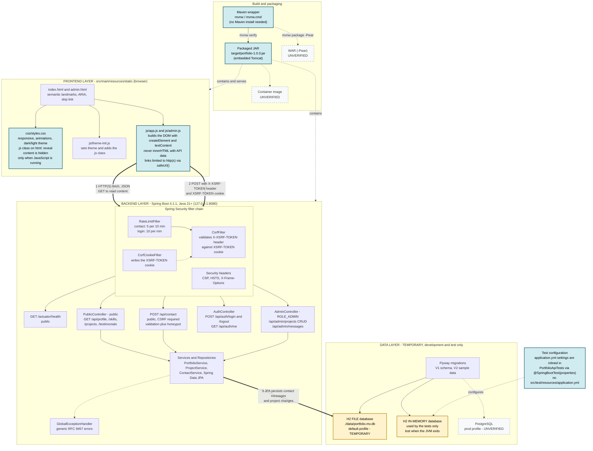
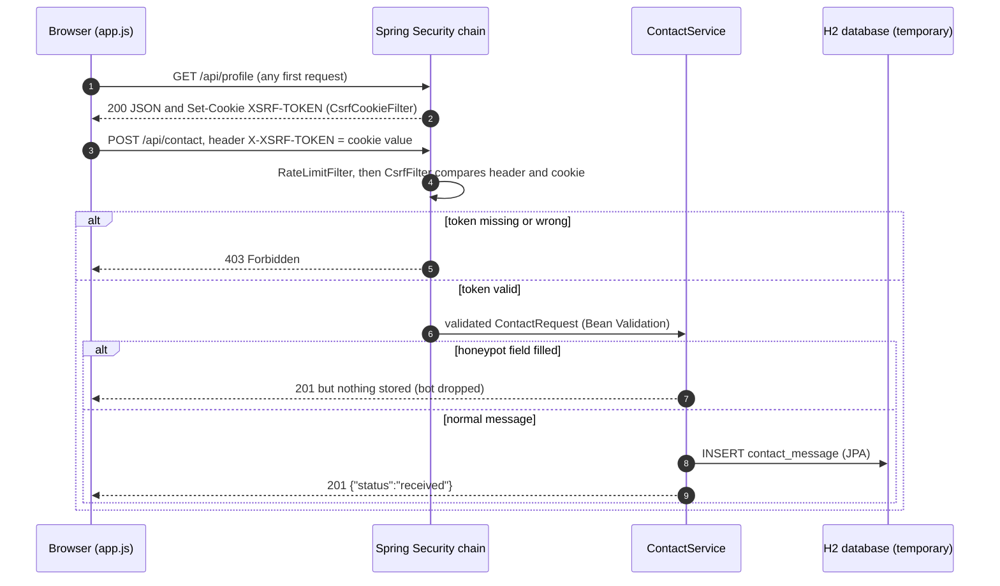

# Animated Portfolio – Java Full Stack

A responsive, animated, accessible portfolio website backed by a Spring Boot REST API and a relational database.

| Layer      | Technology |
|------------|------------|
| Frontend   | HTML5, CSS3, vanilla JavaScript (no build step, no CDN, CSP-friendly) |
| Backend    | Java 21+, Spring Boot 4.1.1, Spring MVC, Spring Data JPA, Bean Validation |
| Security   | Spring Security (session login, BCrypt, CSRF, CSP & security headers, rate limiting) |
| Database   | PostgreSQL (production) · H2 file DB (zero-setup development) · Flyway migrations |
| Packaging  | Executable JAR (embedded Tomcat) **or** WAR for external servlet containers |

## Features

**Frontend** – hero with animated gradient blobs and typing effect · about section with animated counters · skills with animated progress bars · filterable project cards with hover effects · auto-rotating testimonial carousel (pause on hover/focus, keyboard + buttons) · contact form with inline validation · footer · smooth scrolling, scroll-progress bar, active-section nav highlight · dark/light theme · mobile menu · fully responsive (mobile → desktop).

**Accessibility** – semantic landmarks, skip link, visible focus styles, ARIA for menu/carousel/progress bars/form errors/live regions, WCAG AA colour contrast, 44px-ish touch targets, and `prefers-reduced-motion` support (all animation off, content stays visible). Page structure and navigation remain usable without JavaScript, but portfolio content is loaded from the API by JavaScript.

**Backend** – public read APIs, contact form storage, admin API (project CRUD, message inbox), problem-detail (RFC 9457) error responses with no internals leaked.

## Architecture

Quick reference for the current state of the stack. Solid boxes are implemented and covered by the 14 integration tests plus a manual smoke test of the packaged JAR. Dashed boxes are **not yet verified** (see the legend below).



### Form submission and persistence flow



### Legend and status

| Marker | Meaning |
|--------|---------|
| Yellow boxes | **Temporary database.** Suitable for development and testing only. The **file** H2 database (`./data/`) is the default runtime store and is created on first run. The **in-memory** H2 database is used only by the integration tests and disappears when the JVM exits. Neither should be used for a public deployment. |
| Dashed grey boxes | **Not yet verified:** deployment as a WAR, deployment as a container, and the PostgreSQL `prod` profile. They are implemented and documented but have not been run. |
| Blue boxes | Key components: the `.js` class in `styles.css`, the DOM-building scripts, the test configuration inlined in `PortfolioApiTests`, the Maven wrapper and the packaged JAR. |
| Thick arrows | Main data flow: HTTP(S) request, then CSRF validation, then persistence. |

**Verification status**

- Verified: 14 MockMvc integration tests against the full security chain, and a smoke test of the packaged JAR (health, public API, CSRF-protected contact POST, admin login and message listing).
- **Not yet done:** visual testing of the frontend in a browser (animations, responsive layout, theme toggle, carousel, accessibility audit with real assistive technology).
- **Not yet done:** running against PostgreSQL, deploying the WAR to an application server, and building or running a container image.

## Project structure

```
pom.xml                         Maven build (jar by default, -Pwar for WAR)
src/main/java/com/portfolio
  PortfolioApplication.java     Spring Boot entry point
  ServletInitializer.java       WAR deployment bootstrap
  config/                       SecurityConfig, RateLimitFilter, CsrfCookieFilter, AdminProperties
  controller/                   PublicController, AdminController, AuthController
  service/                      PortfolioService, ProjectService, ContactService
  repository/                   Spring Data JPA repositories
  model/                        JPA entities
  dto/Dtos.java                 Request/response records + validation rules
  exception/                    GlobalExceptionHandler, ResourceNotFoundException
src/main/resources
  application.yml               Default (dev) config
  application-prod.yml          Production profile (PostgreSQL, secure cookies)
  db/migration/                 V1 schema, V2 sample content (Flyway)
  static/                       index.html, admin.html, css/, js/
src/test/java                   Integration tests (MockMvc + full security chain)
```

## Run locally (development)

Requirements: **JDK 21 or newer**. Maven is not required (wrapper included).

```powershell
# Windows PowerShell
$env:ADMIN_PASSWORD = "choose-a-long-password"     # >= 12 chars; omit to disable the admin area
./mvnw spring-boot:run
```

```bash
# Linux / macOS
ADMIN_PASSWORD='choose-a-long-password' ./mvnw spring-boot:run
```

Open <http://127.0.0.1:8080> (site) and <http://127.0.0.1:8080/admin.html> (admin; user `admin`).
Data is stored in `./data/portfolio.mv.db` (git-ignored). The server binds to loopback only.

## Customising content

* **Quick start:** sign in at `/admin.html` to add/edit/delete projects and read/delete contact messages.
* **Your profile, skills, testimonials:** replace the sample rows in
  `src/main/resources/db/migration/V2__seed_data.sql` *before the first run* (delete `./data` to re-seed), or ship changes as a new migration `V3__update_content.sql`. Never edit a migration that has already run in production.
* Colours and spacing: design tokens at the top of `static/css/styles.css`.

## Configuration

| Variable | Purpose |
|----------|---------|
| `ADMIN_USERNAME` | Admin user (default `admin`) |
| `ADMIN_PASSWORD_HASH` | **Preferred.** BCrypt hash of the admin password |
| `ADMIN_PASSWORD` | Plain password (min 12 chars), hashed in memory at startup |
| `SPRING_PROFILES_ACTIVE` | `prod` for PostgreSQL & hardened cookies |
| `DB_URL`, `DB_USERNAME`, `DB_PASSWORD` | PostgreSQL connection (prod profile) |
| `SERVER_ADDRESS`, `SERVER_PORT` | Bind address (default `127.0.0.1`) / port |

If neither admin variable is set, the admin API is disabled (fail closed). Secrets are never stored in the repository.

Generate a BCrypt hash (cost 12), e.g. with Spring Boot CLI or any trusted BCrypt tool, then supply it via `ADMIN_PASSWORD_HASH` from your secret store.

## REST API

| Method | Path | Access | Description |
|--------|------|--------|-------------|
| GET | `/api/profile` | public | Owner profile, bio paragraphs, stats |
| GET | `/api/skills` | public | Skills with levels and categories |
| GET | `/api/projects` | public | Projects (ordered) |
| GET | `/api/testimonials` | public | Testimonials |
| POST | `/api/contact` | public, rate-limited (5 / 10 min / IP) | Submit contact form |
| POST | `/api/auth/login` | public, rate-limited (10 / min / IP) | Form login (`username`, `password`) |
| POST | `/api/auth/logout` | session | End session |
| GET | `/api/auth/me` | admin | Current user |
| POST/PUT/DELETE | `/api/admin/projects[/{id}]` | admin | Manage projects |
| GET | `/api/admin/messages` | admin | List messages |
| PATCH | `/api/admin/messages/{id}/read` | admin | Mark as read |
| DELETE | `/api/admin/messages/{id}` | admin | Delete message |
| GET | `/actuator/health` | public | Health probe |

State-changing requests need the `X-XSRF-TOKEN` header (value of the `XSRF-TOKEN` cookie) – the bundled JavaScript does this automatically. Every other path is denied by default.

## Build & test

```bash
./mvnw verify                 # compile + 14 integration tests + executable JAR
# → target/portfolio-1.0.0.jar
```

## Deployment

### Option A – Executable JAR (recommended)

```bash
# PostgreSQL (create an empty database and a least-privilege user first)
export SPRING_PROFILES_ACTIVE=prod
export DB_URL='jdbc:postgresql://db.internal:5432/portfolio?sslmode=verify-full'
export DB_USERNAME=portfolio_app
export DB_PASSWORD='…from your secret store…'
export ADMIN_PASSWORD_HASH='$2a$12$…'
java -jar target/portfolio-1.0.0.jar
```

The app listens on `127.0.0.1:8080`. Put a TLS-terminating reverse proxy (nginx, Apache, HAProxy, an OpenShift route …) in front of it, forwarding `X-Forwarded-For/Proto/Host`. Use TLS 1.2+ (1.3 preferred) with a valid certificate. Run the process as a non-root service user (systemd unit, etc.).

If the proxy runs on a different host, set `SERVER_ADDRESS` to the specific internal IP – do not bind `0.0.0.0`.

### Option B – WAR on an application server

```bash
./mvnw clean package -Pwar     # → target/portfolio-1.0.0.war
```

Deploy to Tomcat 11, WildFly, Open Liberty or JBoss EAP (Jakarta EE 11 / Servlet 6.1 required). Set the same environment variables / system properties (`-Dspring.profiles.active=prod`, …) on the server. To serve at the root context, name the file `ROOT.war` (Tomcat).

### Option C – Container

Use a minimal Red Hat UBI image and a non-root user, for example:

```dockerfile
FROM registry.redhat.io/ubi9/openjdk-21-runtime:latest
COPY target/portfolio-1.0.0.jar /deployments/app.jar
USER 185
EXPOSE 8080
ENTRYPOINT ["java", "-jar", "/deployments/app.jar"]
```

Inside a container the process must listen on the container interface; set `SERVER_ADDRESS` to the pod/container IP (or enable your platform's equivalent) and restrict exposure through the platform's ingress. Run with a read-only root filesystem and all capabilities dropped. Scan the image and verify its signature before deployment.

## Security notes

* No secrets in code; admin credential from environment/secret store, BCrypt (cost 12).
* CSRF protection on, `SameSite=Strict` cookies, `HttpOnly` session cookie (`Secure` in prod).
* Strict CSP (no inline scripts/styles), HSTS, `X-Frame-Options: DENY`, `nosniff`, Referrer & Permissions policies.
* Server-side validation on every input; URLs restricted to `http(s)`; output rendered with `textContent` only.
* Contact form: honeypot field, size limits and per-IP rate limiting (in-memory – use a gateway/Redis limiter if you run multiple instances).
* Generic error responses; stack traces only in server logs; no PII in logs.
* Remember to run dependency scanning (e.g. Mend) and SAST in CI, and keep dependencies current.

## Production hardening checklist

- [ ] Replace the sample data (V2 migration) with your own content
- [ ] Provide `ADMIN_PASSWORD_HASH` from a secret manager and rotate periodically; add MFA at the proxy/IdP (OIDC/SAML) for admin access if exposed publicly
- [ ] Enable TLS at the proxy and DB connections (`sslmode=verify-full`)
- [ ] Configure log shipping and alerting on failed logins (retain ≥ 90 days)
- [ ] Schedule database backups
